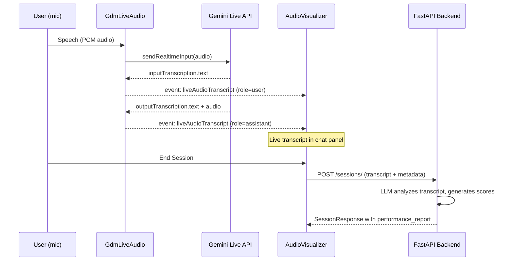

# Performance Reports from Gemini Live Sessions

## Current State

- Gemini Live sessions produce audio only -- no text is captured or stored
- AI text parts arrive in `onmessage` but are only used for status strings (`updateStatus`)
- User speech is never transcribed
- The chat panel in `AudioVisualizer.tsx` uses fake hardcoded assistant replies
- No session data is POSTed to the backend -- `SessionResponse` records with `performance_report` have no source data from live sessions
- Backend already uses LLM analysis to generate `performance_report` (scores + coaching summary) from conversation data

## Solution

Use Gemini Live API's built-in `inputAudioTranscription` and `outputAudioTranscription` to get real-time text of both sides of the conversation, accumulate a transcript, show it live, and send it to the backend for report generation.




---

## Part 1 -- GdmLiveAudio.ts (capture transcription)

**Minimal changes, follow existing patterns.**

### 1a. Enable transcription in session config

In `initSession()` (line ~592), add to the `config` object passed to `live.connect`:

```typescript
config: {
  responseModalities: [Modality.AUDIO],
  inputAudioTranscription: {},
  outputAudioTranscription: {},
  // ...existing systemInstruction, etc.
}
```

### 1b. Add transcript accumulator

Add a private property to the class:

```typescript
private transcript: Array<{ role: 'user' | 'assistant'; text: string; timestamp: number }> = [];
```

Clear it in `initSession()` before connecting.

### 1c. Capture transcription in onmessage

In the existing `onmessage` callback (line ~606), add handling for the two new fields from `serverContent`:

- `message.serverContent?.inputTranscription?.text` -- what the user said
- `message.serverContent?.outputTranscription?.text` -- what the AI said (text version of audio)

Each non-empty transcription text gets pushed to `this.transcript` and dispatched as a window event:

```typescript
window.dispatchEvent(new CustomEvent('liveAudioTranscript', {
  detail: { role: 'user' | 'assistant', text: '...' }
}));
```

### 1d. Expose transcript on session end

Add a public method `getTranscript()` that returns the accumulated array. Also dispatch a `liveAudioSessionComplete` event with the full transcript when the session closes (in `onclose` callback or `closeSession`).

---

## Part 2 -- AudioVisualizer.tsx (live display + session submission)

**Follow existing patterns, minimal changes.**

### 2a. Replace fake chat with live transcript

Remove the `setTimeout` fake assistant reply in `handleSendMessage`. Instead, listen for `liveAudioTranscript` events and append real `Message` entries to the existing `messages` state:

```typescript
useEffect(() => {
  const handler = (e: CustomEvent) => {
    const { role, text } = e.detail;
    if (!text?.trim()) return;
    setMessages(prev => [...prev, {
      id: Date.now().toString(),
      role,
      content: text,
      timestamp: new Date()
    }]);
  };
  window.addEventListener('liveAudioTranscript', handler);
  return () => window.removeEventListener('liveAudioTranscript', handler);
}, []);
```

The existing transcript UI (lines 803-871) already renders `messages` with role-based styling -- no changes needed there.

### 2b. Submit session on end

In `endSession()`, before clearing state, POST the transcript and session metadata to the backend:

```typescript
const endSession = async () => {
  document.dispatchEvent(new CustomEvent('liveAudioStopMic'));
  const transcript = liveAudioRef.current?.getTranscript?.() ?? [];
  if (transcript.length > 0) {
    await apiCreateSession({
      persona_id: sessionData?.persona?.id,
      mode: sessionData?.mode,
      transcript,
      duration: 1800 - timeLeft,
    });
  }
  setMessages([]);
  // ...existing cleanup
};
```

---

## Part 3 -- Service layer (follow existing patterns)

### 3a. Endpoint config

Add to `[src/configs/endpoint.config.ts](src/configs/endpoint.config.ts)`:

```typescript
sessionsCreate: 'sessions/',
```

### 3b. Session service

Add to `[src/services/SessionService.ts](src/services/SessionService.ts)`:

```typescript
export async function apiCreateSession(data: {
  persona_id?: string;
  mode?: string;
  transcript: Array<{ role: string; text: string; timestamp: number }>;
  duration: number;
}) {
  return ApiService.fetchDataWithAxios<SessionResponse>({
    url: endpointConfig.sessionsCreate,
    method: 'post',
    data,
  });
}
```

Uses `ApiService` + `AxiosBase` so auth token is attached automatically.

---

## Part 4 -- Backend instructions (update existing MD)

Append a new section to `[BACKEND_EPHEMERAL_TOKEN_SETUP.md](BACKEND_EPHEMERAL_TOKEN_SETUP.md)` (or create a separate `BACKEND_SESSION_REPORT_SETUP.md`) documenting:

- `**POST /api/v1/sessions/**` endpoint spec -- request body schema (persona_id, mode, transcript array, duration)
- How to use Gemini (non-live, regular `generateContent`) to analyze the transcript and produce `performance_report` (overall_score, coaching_summary, per-skill scores)
- Suggested prompt template for LLM analysis
- Response schema matching existing `SessionResponse` type
- Store session in DB for `GET /sessions/by-user/:userId`

---

## Files touched (summary)

- `[src/liveAudio/GdmLiveAudio.ts](src/liveAudio/GdmLiveAudio.ts)` -- enable transcription config, accumulate transcript, dispatch events, expose getter
- `[src/views/sales/AudioVisualizer.tsx](src/views/sales/AudioVisualizer.tsx)` -- listen for transcript events, replace fake chat, POST on session end
- `[src/configs/endpoint.config.ts](src/configs/endpoint.config.ts)` -- add `sessionsCreate`
- `[src/services/SessionService.ts](src/services/SessionService.ts)` -- add `apiCreateSession`
- `BACKEND_EPHEMERAL_TOKEN_SETUP.md` or new `BACKEND_SESSION_REPORT_SETUP.md` -- backend endpoint + LLM prompt docs

